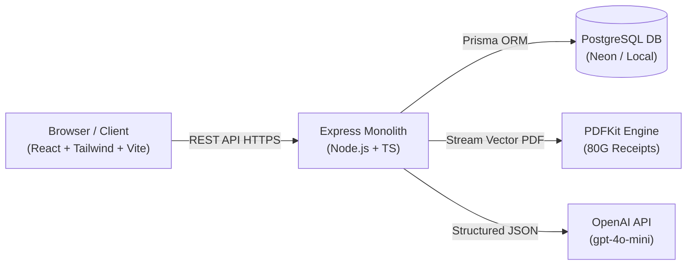

# SakhiSetu (सखीसेतु)

> **Empowering Women. Connecting Opportunities. Creating Change.**  
> *"हर महिला के लिए एक बेहतर अवसर।"*

SakhiSetu is an enterprise-grade full-stack web application designed for **Company A**, a registered charitable trust in Bhopal, Madhya Pradesh. Operating across nine districts, the trust works in women's livelihood development, maternal healthcare, and social security.

SakhiSetu replaces manual Word certificates, spreadsheets, and fragmented WhatsApp dissemination with a unified platform featuring **bilingual government scheme discovery**, a **deterministic eligibility engine**, **concurrency-safe 80G tax receipting**, **Form 10BD electronic return exports**, and a **human-in-the-loop OpenAI plain-Hindi summary workflow**.

---

## 🌟 Key Features

### 1. Bilingual Government Scheme Discovery (`/schemes`)
- Verified directory of central and Madhya Pradesh state schemes (including client-provided schemes: **SCH-014** State Widow Pension, **SCH-022** SHG Livelihood Loan Support, **SCH-031** PMMVY Maternity Cash Benefit, **SCH-067** Ladli Behna, and **SCH-058** Gaon Ki Beti).
- Filter by category, need (Pension, Livelihood, Health, Education), and district (all 9 MP districts).
- Comprehensive details: official benefit amounts, required documents checklist, step-by-step application workflow, nearest collectorate/panchayat help centre, official portal links, and last-verified timestamps.

### 2. Deterministic Eligibility Finder (`/eligibility`)
- Multi-step questionnaire (6 simple questions) covering district, age, occupation, marital status, SHG membership, and BPL card entitlement.
- **Strictly deterministic rule evaluation** in PostgreSQL/TypeScript — zero AI hallucinations determining legal eligibility.
- Categorizes results into 100% matched schemes (with explicit reasons and satisfied criteria) and potential partial matches with missing requirements.
- Citizen helpline callback request mechanism ("सखीसेतु सहायता अनुरोध") connecting users to local field workers.

### 3. Donation Workflow & Payment Simulation (`/donate`)
- Support for one-time and monthly recurring donations (test-mode simulation).
- Pre-set amounts (₹500, ₹1,000, ₹2,500, ₹5,000) or custom input.
- Strict client-mandated **FCRA restriction notice & foreign card rejection** — foreign contributions are actively blocked at both UI and API levels.
- Interactive **Payment Gateway Simulator**: test UPI (simulated QR), Debit/Credit Cards, and Net Banking with one-click toggles for Success, Bank Decline, or Pending state.

### 4. Concurrency-Safe Receipting & 80G PDF Generation
- Concurrency-safe atomic receipt sequence allocator (`SAKHI/80G/YYYY-YY/000001`) utilizing PostgreSQL row-level locks and `UPDATE ... RETURNING`.
- **Idempotent processing**: double clicks or network retries return the existing receipt without duplicate sequence allocation.
- **Zero failure receipts**: declined or pending payments never issue receipts or increment the sequence counter.
- **Instant vector PDF generation** via PDFKit: authentic 80G demonstration certificate complete with trust credentials, statutory Section 80G(5)(vi) declarations, donor PAN, amount in figures and words, and official trust seal.

### 5. Donor Self-Service Portal (`/donor/dashboard`)
- Authenticated donor accounts with personal donation history.
- Masked PAN display for privacy (`AB******4F`).
- One-click downloads of past 80G PDF receipts and aggregate annual donation statements.

### 6. Trust Administration Desk (`/admin`)
- **Executive Dashboard**: Real-time database metrics, Recharts monthly contribution trends, and campaign progress bars.
- **Schemes CMS**: Full CRUD, draft saving, publishing, archiving, and last-checked updates.
- **Campaign Manager**: Fund goals, collected amounts, and donor milestones.
- **Donation Registry**: Search by donor, PAN, or receipt number with audit trail.
- **Form 10BD Electronic Return Suite**: Automatic compilation of annual donor PANs and contributions with **one-click CSV export** formatted for the Income Tax Department.

### 7. AI Plain-Hindi Summary Integration (`/admin/ai-reviews`)
- Integrated with official **OpenAI Node.js SDK** using configurable `OPENAI_MODEL` (`gpt-4o-mini`).
- Synthesizes complex official scheme gazettes into clear, grassroots Hindi understandable to rural women.
- **Human-in-the-Loop Review Desk**: AI outputs enter PostgreSQL in `PENDING` status. Trust admins inspect, edit text inline, and explicitly click `Approve & Publish` or `Reject`. AI content is **never published automatically**.

---

## 🛠️ Technology Stack

| Layer | Technologies Used |
|---|---|
| **Frontend** | React 18/19, TypeScript, Vite, Tailwind CSS, Lucide React, React Router v7, TanStack Query, React Hook Form, Zod, Recharts |
| **Backend** | Node.js, Express.js, TypeScript, Prisma ORM, PostgreSQL, PDFKit, bcryptjs, jsonwebtoken, Helmet, CORS, express-rate-limit |
| **AI Integration** | Official OpenAI Node.js SDK (`gpt-4o-mini`, structured JSON mode, Zod runtime validation) |
| **Testing** | Vitest, Supertest, PostgreSQL Concurrency Suite |
| **Hosting Target** | Vercel (Frontend), Render / Railway (Backend), Neon (PostgreSQL) |

---

## 🏗️ Architecture



---

## 🚀 Quick Start (Local Setup)

### 1. Prerequisites
- Node.js v20+ or v22+
- npm v10+
- PostgreSQL running on localhost:5432

### 2. Install Dependencies
```bash
# In project root
npm install
```

### 3. Setup Databases
```bash
createdb sakhisetu
createdb sakhisetu_test
```

### 4. Configure Environment
```bash
cp server/.env.example server/.env
```
*(Ensure `DATABASE_URL=postgresql://<user>@localhost:5432/sakhisetu` and `DATABASE_URL_TEST=postgresql://<user>@localhost:5432/sakhisetu_test`)*

### 5. Run Migrations & Seed Demonstration Data
```bash
npm run prisma:generate
npm run prisma:migrate
npm run prisma:seed
```

### 6. Start Development Servers
```bash
npm run dev
```
- Client runs at: [http://localhost:5173](http://localhost:5173)
- Server runs at: [http://localhost:5001](http://localhost:5001)

---

## 🧪 Automated Testing

SakhiSetu includes 38+ comprehensive automated tests covering unit logic, real PostgreSQL concurrency safety, and full REST integration flows:

```bash
# Run all tests (Server and Client)
npm test

# Run Server Tests Only (38 passing tests)
npm run test:server

# Run PostgreSQL Concurrency Tests (Row locking & Atomic sequence verification)
npm --prefix server run test:concurrency

# Run Client Tests
npm run test:client
```

---

## 🔑 Demo Accounts

Use these documented accounts to test role-based access control (RBAC):

| Role | Email | Password | Access |
|---|---|---|---|
| **Trust Administrator** | `admin@sakhisetu.org` | `Admin@123456` | Full Admin Dashboard, Scheme CMS, AI Review Desk, Form 10BD Export |
| **Donor 1 (Priya Sharma)** | `priya.sharma@example.com` | `Donor@123456` | Donor Portal, Contribution History, Download 80G Receipts |
| **Donor 2 (Rajesh Patel)** | `rajesh.patel@example.com` | `Donor@123456` | Donor Portal, Recurring Simulated Donations |
| **Public Visitor** | *(No login required)* | — | Browse Schemes, Eligibility Calculator, Make Test Donations |

*One-click quick-fill buttons are provided on the Login page for rapid demonstration.*

---

## 📚 Documentation Index
- [Architecture Blueprint](docs/architecture.md)
- [Database Schema & ER Reference](docs/database-design.md)
- [Comprehensive Technical Design Document](docs/technical-design.md)
- [Deployment & Operations Guide](deployment.md)

---

## ⚖️ Legal & Non-Profit Notice
- **Statutory 80G Exemption**: Donations to SakhiSetu are eligible for 50% deduction under Section 80G(5)(vi) of the Income Tax Act, 1961. Receipts generated are demonstration documents for code evaluation and interview take-home assignment review.
- **FCRA Compliance**: Foreign currency contributions and non-Indian credit cards are strictly blocked under Phase 1 restrictions.

